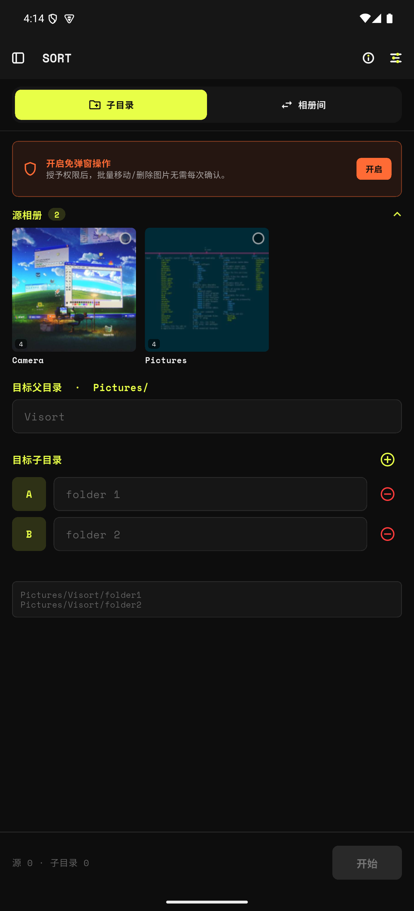
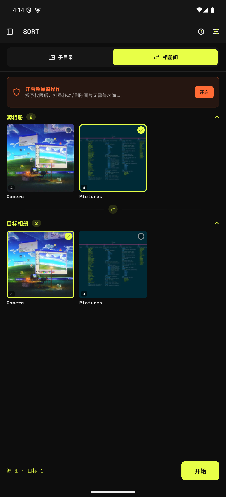
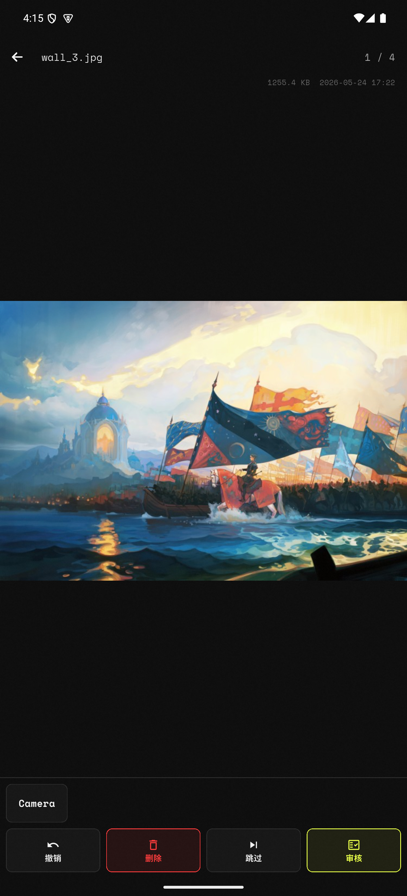
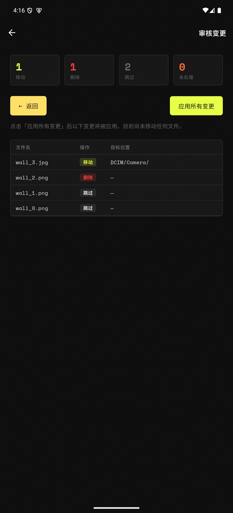
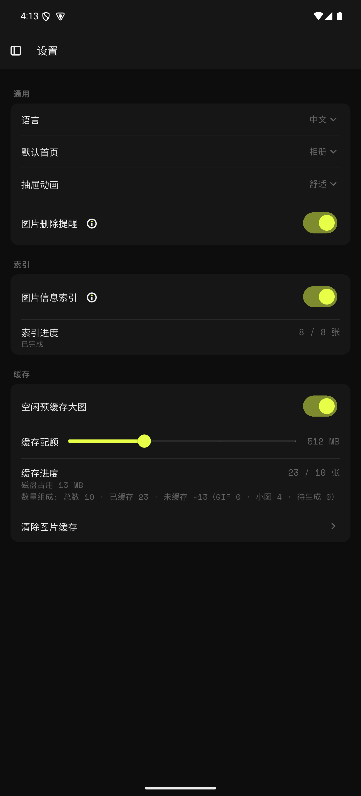

<div align="center">

# VISORT

**键盘 / 手势驱动的图片整理 + 相册** — 安卓 + Windows

逐张浏览，一键分类，确认前不碰任何文件。

[**English**](readme.md)

[](https://flutter.dev)
[](https://dart.dev)
[](LICENSE)

</div>

---

## 为什么不是又一个相册？

主流相册（Google Photos、各厂商系统相册）擅长**浏览**，但**整理**很弱——要么手动长按逐张选中再移动，慢到让人放弃；要么交给 AI 自动分类，黑盒且不可控。结果就是照片越堆越多，永远懒得理。

VISORT 是一个**整理工具**，不是看图器：

- **一键一决策的流水线** — 全屏看一张图，点一个目标即刻分类，下一张自动接上。几分钟过完几百张，像流水线一样顺。
- **暂存 + 复核，绝不误操作** — 所有移动 / 删除先进内存暂存，执行前给完整的统计预览，确认才落地。删除走系统回收站，可恢复。
- **完全本地，零云端** — 图片不离开设备，没有 AI 扫描、没有上传、没有账号。你的照片就是你的。
- **两种整理模式** — 相册间移动（Pictures → Camera），或按自定义子目录规则分类（键 A →「保留」，键 B →「待删」），适配任何整理习惯。
- **完整的相册生态** — 浏览、收藏、回收站、搜索、壁纸、多选批量操作，一样不少。

> 核心设计原则：**所有操作先暂存，确认后才执行。** 不会误删、不会误移。

## 平台

| 平台 | 状态 | 特色 |
|---|---|---|
| **安卓** | 活跃开发 · 相册体验为核心 | MediaStore 原生相册 + 触屏整理流水线 |
| **Windows 桌面** | 稳定 · 功能完整 | 键盘驱动分类，窗口状态持久化 |

代码库是 [`visort_flutter/`](visort_flutter/) 下的 **Flutter 应用**，移植自早期的 Python / Flask 实现（已移除）。

---

## 安卓版

原生 MediaStore 集成，直接操作系统相册，零拷贝。以下全部为模拟器实拍。

### 相册浏览

<p align="center">
  
  &nbsp;
  
</p>

keyset 游标分页的 MediaStore 图库，ContentObserver 实时刷新——相册外的增删改即时反映到列表。顶栏支持按文件名搜索（本地索引）、筛选排序；长按相册可多选批量清空。

### 大图查看

<p align="center">
  
</p>

全屏查看器：双指缩放、左右滑动切换、底部缩略图条（删除自动补位）。一键收藏、删除（走系统回收站）、设为壁纸、查看元信息。

### 整理配置

<p align="center">
  
  &nbsp;
  
</p>

两种模式：**相册间**（源 → 目标，支持多选）或**子目录**（自定义目标父目录 + 子目录规则，键 A / B 一键分流）。授予媒体管理权限后可开启免弹窗批量操作。

### 逐张裁决

<p align="center">
  
</p>

全屏看一张图，点底部目标即分类（目标相册 / 删除 / 跳过 / 撤销），下一张自动接上——无需长按多选，几分钟过完几百张。

### 复核 · 执行

<p align="center">
  
  &nbsp;
  
</p>

执行前给出完整统计（已移 / 已删 / 已跳过）与逐文件明细表——此刻所有操作仍在内存，文件未动。确认后一次性应用，批量移动 / 删除只需一次系统授权。

### 收藏 · 回收站

<p align="center">
  
  &nbsp;
  
</p>

收藏跨相册聚合视图；删除的照片进入系统回收站，随时恢复或一键清空。

### 设置

<p align="center">
  
</p>

语言（中 / 英）、默认首页、抽屉动画、图片信息索引、空闲预缓存与缓存配额，全部本地持久化。

---

## Windows 桌面端

> 截图待补充。

- **键盘优先** — 单键移动 / 删除 / 跳过，全屏逐张裁决，效率远超鼠标点选
- **暂存执行** — 同安卓版，所有操作入内存队列，Run 前不动文件系统
- **窗口记忆** — 位置 / 尺寸持久化，下次打开还原
- **冲突处理** — 同名文件自动加数字后缀，永不覆盖

---

## 快速开始

需要 [Flutter ≥ 3.47](https://flutter.dev)（Dart ≥ 3.10）。

```bash
git clone https://github.com/synxvi/visort.git
cd visort/visort_flutter
flutter pub get
flutter run -d android        # 安卓真机 / 模拟器
flutter run -d windows        # Windows 桌面
```

构建：

```bash
flutter build apk --release --split-per-abi \
  --obfuscate --split-debug-info=build/symbols   # → build/app/outputs/flutter-apk/
flutter build windows --release                 # → build/windows/x64/runner/Release/
```

> 安卓 release 已配置生产签名；`--split-debug-info` 剥离 Dart 符号（libapp.so 减重 ~1.2MB），符号文件归档保留用于反混淆崩溃堆栈。

## 支持格式

18 种：JPG · PNG · GIF · BMP · WEBP · TIFF · TIF · SVG · ICO · HEIC · HEIF · RAW · CR2 · NEF · ARW · DNG · AVIF

## 技术栈

| 层 | 技术 |
|---|---|
| 界面 / 逻辑 | Flutter（Dart ≥ 3.10），Riverpod ^2.6.1 |
| 安卓原生 | Kotlin + MediaStore（MethodChannel + EventChannel + ContentObserver） |
| Windows 原生 | CMake 运行器（C++17） |
| 持久化 | SQLite（会话 / 快照 / 搜索索引 / 运行日志） |
| 测试 | `flutter_test`，208 个单测用例 |

## 文档

- [`AGENTS.md`](AGENTS.md) — 权威的架构与开发指南
- [`docs/ANDROID_ROADMAP.md`](docs/ANDROID_ROADMAP.md) — 安卓端口决策（A0–A4、SAF→MediaStore、v2 相册）
- [`visort_flutter/README.md`](visort_flutter/README.md) — Flutter 应用快速上手

## 许可证

[MIT License](LICENSE)
