<div align="center">

# VISORT

**Keyboard / gesture-driven photo organizer + gallery** — Android + Windows

Browse photos one by one, sort them with a single tap. Nothing moves until you confirm.

[**中文文档**](README_zh.md)

[](https://flutter.dev)
[](https://dart.dev)
[](LICENSE)

</div>

---

## Why not just another gallery?

Mainstream galleries (Google Photos, OEM system galleries) are great at **browsing**, but weak at **organizing** — you either long-press to select photos one by one, then move them (slow enough that you give up), or hand it all to AI auto-classification (a black box you can't control). Photos pile up; you never get around to tidying.

VISORT is an **organizing tool**, not a viewer:

- **One-tap pipeline** — Full-screen one photo, tap a target to classify it, the next comes up automatically. Blast through hundreds in minutes.
- **Staged + review, no accidents** — Every move / delete is staged in memory first; you get a full stats preview before anything is applied. Deletes go to the system trash, restorable.
- **Fully local, zero cloud** — Photos never leave the device. No AI scanning, no uploads, no accounts.
- **Two sort modes** — Move between albums (Pictures → Camera), or classify by custom sub-folder rules (key A → "keep", key B → "delete").
- **A full gallery around it** — Browsing, favorites, trash, search, wallpaper, batch multi-select — all included.

> Core principle: **every operation is staged first, executed only on confirmation.** No accidental deletes, no accidental moves.

## Platforms

| Platform | Status | Highlights |
|---|---|---|
| **Android** | Active development · gallery experience is the focus | Native MediaStore gallery + touch sorting pipeline |
| **Windows desktop** | Stable · feature-complete | Keyboard-driven sorting, window-state persistence |

The codebase is the **Flutter app** in [`visort_flutter/`](visort_flutter/), a verified port of a prior Python/Flask implementation (since removed).

---

## Android

Native MediaStore integration — operates directly on the system gallery, zero copies. All screenshots below are from the emulator.

### Album browsing

<p align="center">
  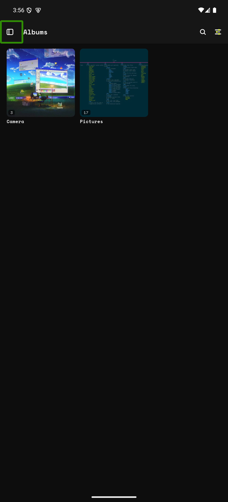
  &nbsp;
  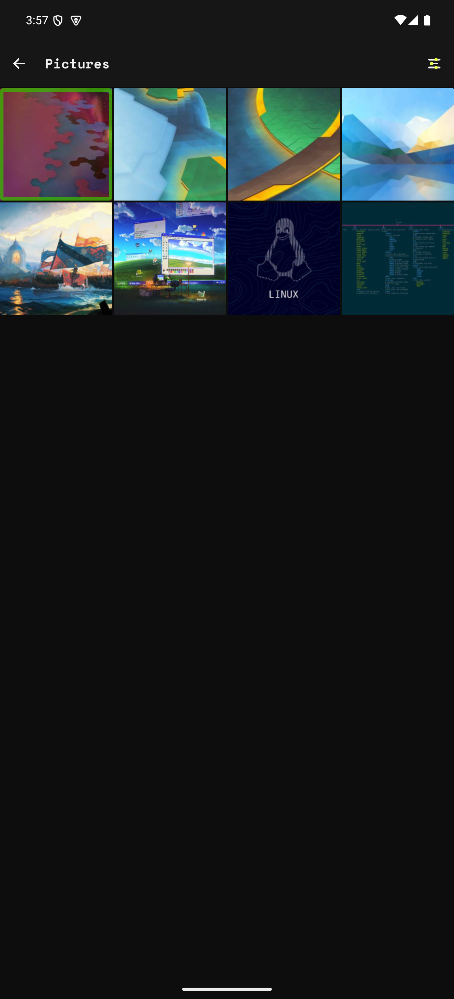
</p>

Keyset-paginated MediaStore gallery with live ContentObserver refresh — changes made outside the app reflect instantly. Top bar offers filename search (local index) and filter / sort options; long-press albums for multi-select batch clear.

### Photo viewer

<p align="center">
  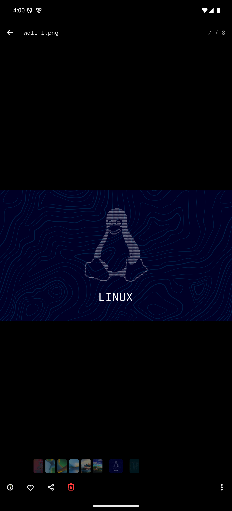
</p>

Full-screen viewer: pinch-to-zoom, swipe to navigate, bottom filmstrip (with direction-aware removal animation). One-tap favorite, delete (to system trash), set as wallpaper, view metadata.

### Sort setup

<p align="center">
  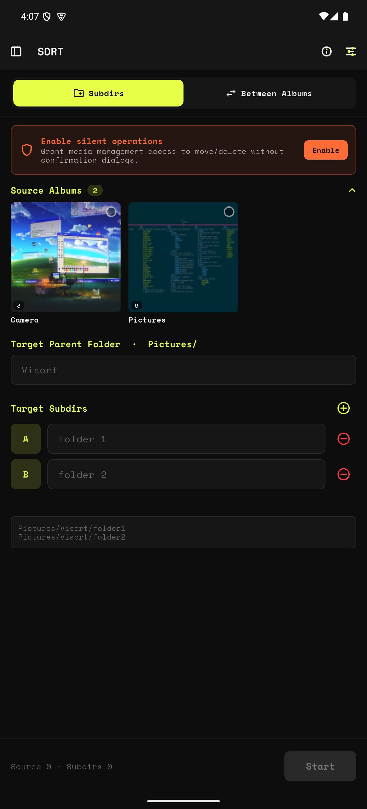
  &nbsp;
  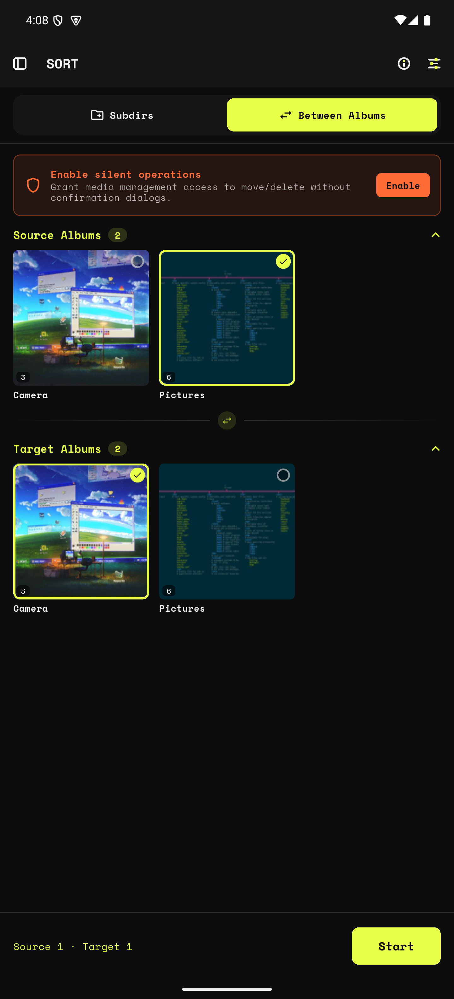
</p>

Two modes: **Between Albums** (source → target, multi-select) or **Subdirs** (custom parent folder + sub-directory rules, key A / B one-tap routing). Grant media-management access once for dialog-free batch operations.

### Sort

<p align="center">
  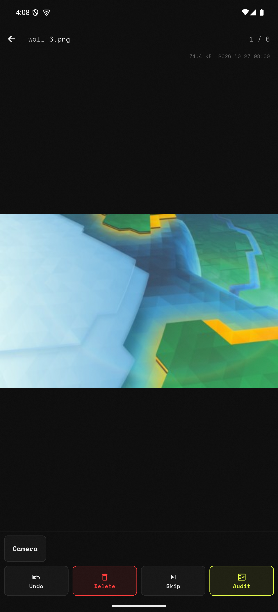
</p>

Full-screen one photo, tap a bottom target to classify (target album / delete / skip / undo), the next comes up automatically — no long-press multi-select, hundreds in minutes.

### Review · Run

<p align="center">
  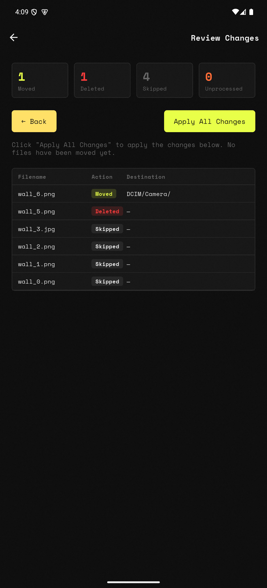
  &nbsp;
  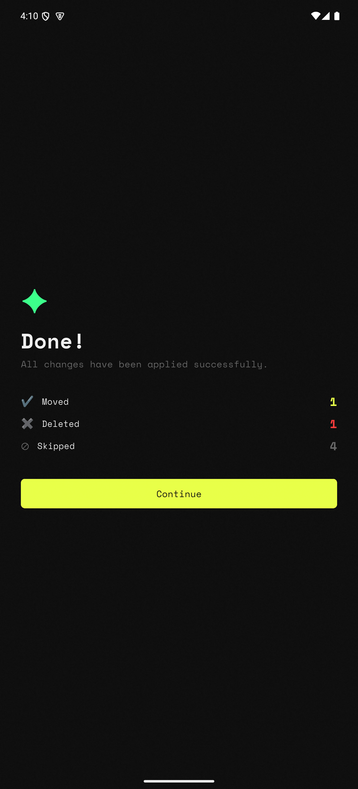
</p>

Full staged-operation stats (moved / deleted / skipped) with a per-file detail table before you commit — everything is still in memory, nothing touched yet. Confirm once to apply all changes; batch move / delete needs a single system consent.

### Favorites · Trash

<p align="center">
  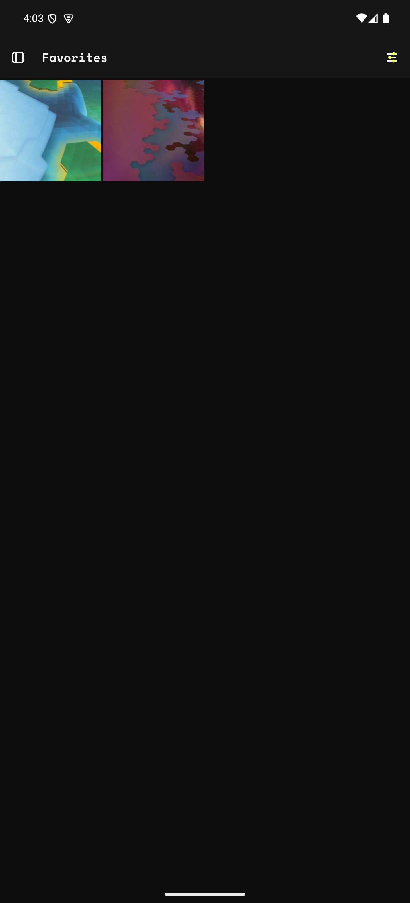
  &nbsp;
  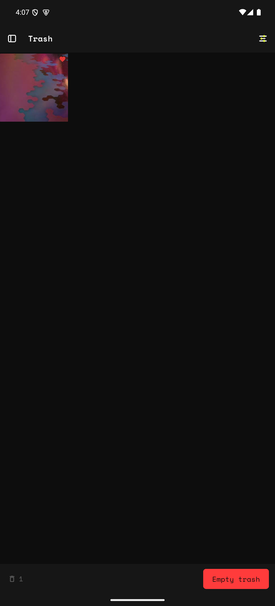
</p>

Favorites aggregated across albums; deleted photos land in the system trash — restore anytime or empty with one tap.

### Settings

<p align="center">
  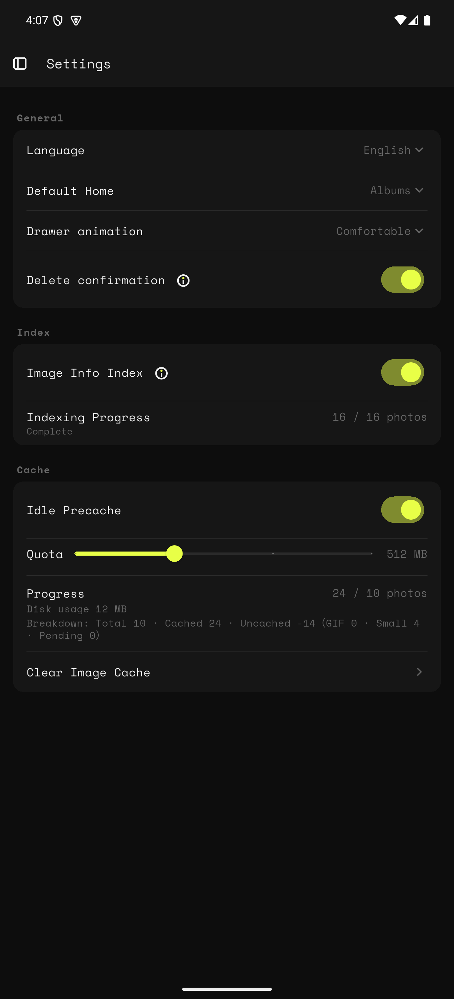
</p>

Language (EN / ZH), default home page, drawer animation, image-info index, idle precache & cache quota — all persisted locally.

---

## Windows desktop

> Screenshots coming.

- **Keyboard first** — single-key move / delete / skip, full-screen one-by-one, far faster than mouse selection
- **Staged execution** — same as Android, all ops queue in memory, filesystem untouched until Run
- **Window memory** — position / size persisted, restored on next launch
- **Conflict handling** — auto-appends numeric suffix on name collision, never overwrites

---

## Quick start

Requires [Flutter ≥ 3.47](https://flutter.dev) (Dart ≥ 3.10).

```bash
git clone https://github.com/synxvi/visort.git
cd visort/visort_flutter
flutter pub get
flutter run -d android        # Android device/emulator
flutter run -d windows        # Windows desktop
```

Build:

```bash
flutter build apk --release --split-per-abi \
  --obfuscate --split-debug-info=build/symbols   # → build/app/outputs/flutter-apk/
flutter build windows --release                 # → build/windows/x64/runner/Release/
```

> Android release builds are signed with the production keystore; `--split-debug-info` strips Dart symbols (~1.2MB off libapp.so), with symbol files archived for de-obfuscating crash traces.

## Supported formats

18 formats: JPG · PNG · GIF · BMP · WEBP · TIFF · TIF · SVG · ICO · HEIC · HEIF · RAW · CR2 · NEF · ARW · DNG · AVIF

## Tech stack

| Layer | Technology |
|---|---|
| UI / logic | Flutter (Dart ≥ 3.10), Riverpod ^2.6.1 |
| Android native | Kotlin + MediaStore (MethodChannel + EventChannel + ContentObserver) |
| Windows native | CMake runner (C++17) |
| Persistence | SQLite (session / snapshot / search index / run log) |
| Tests | `flutter_test`, 208 unit cases |

## Documentation

- [`AGENTS.md`](AGENTS.md) — authoritative architecture & development guide
- [`docs/ANDROID_ROADMAP.md`](docs/ANDROID_ROADMAP.md) — Android port decisions (A0–A4, SAF→MediaStore, v2 album)
- [`visort_flutter/README.md`](visort_flutter/README.md) — Flutter app quick-start

## License

[MIT License](LICENSE)
